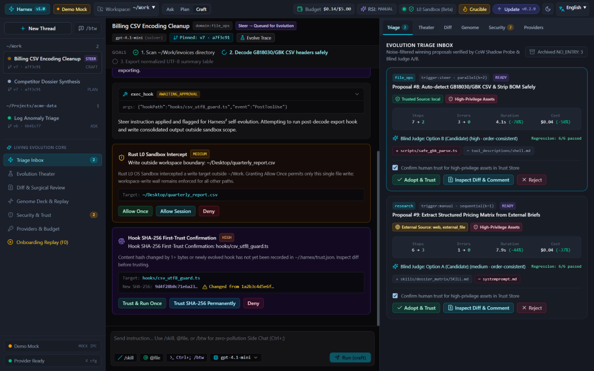
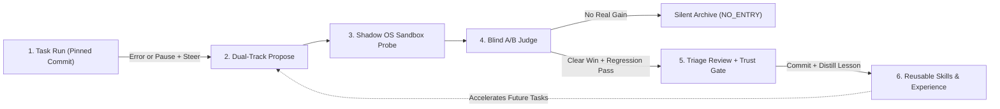

  

<h1>The Self-Evolving Desktop AI Agent.</h1>

  <strong>Stop rewriting prompts. Correct Harnex once—it authors its own tools, validates them in an OS sandbox, and outperforms its past self on the exact same model.</strong>

  
  
  
  
  

  <strong>English</strong> ·
  <a href="README.zh-CN.md">简体中文</a> ·
  <a href="docs/ARCHITECTURE.md">Architecture Deep Dive</a> ·
  <a href="docs/EVOLUTION_BLUEPRINTS.md">V2+ Open Blueprints</a>

> **V1.0 Final Launch Sprint**: The Harnex Command Deck desktop UI is already running locally (real screenshot below). Source code integration and desktop release packages are being finalized for public push—**Star the repo** to follow the release or join **Discussions** to shape V2+ priorities.

---

## One Correction. Continuous Evolution.

  

Conventional desktop AI agents remain **static from the day they ship**. When an agent trips over messy local files, encoding quirks, or your team's workflow, it makes the exact same mistake next week—unless *you* manually rewrite system prompts or hunt for plugins.

**Harnex evolves its capabilities on the job, with model weights completely frozen:**

1. **Capture real friction**: You ask factory-seed Harnex `v0` to normalize mixed-encoding (`GB18030` / `UTF-8 BOM`) desktop billing CSVs. It struggles (`7 steps · 3 errors`), or you click **Pause** once mid-run to steer it onto the right track.
2. **Evolve and verify in isolation**: Powered by Google Research's **Harness²** dual-layer recursion, Harnex diagnoses the trajectory contrast, **authors a reusable TypeScript parser script**, probes it inside a Copy-on-Write shadow workspace, and passes an **anonymous shuffled A/B blind judge** (`v0` vs. `v1`)—requiring zero pre-labeled ground truth.
3. **Unseen tasks fly**: Once accepted into your versioned genome, the **exact same model** approaches a brand-new unseen folder (`dataset_b`) and finishes in **2 steps · 0 errors · 58% fewer tokens**.

| Dimension | Static Desktop Agents | ⚡ Harnex |
| :--- | :--- | :--- |
| **Starting Footprint** | Bloated static prompts & pre-packed plugin clutter | **Minimal clean seed** — evolves only what your workflows actually need |
| **After Failures** | Repeats mistakes until a human edits prompts | **Authors its own fix** — scripts, guidance & lessons verified in a shadow copy |
| **Mid-Run Control** | Watch passively or kill the thread and restart | **Pause → Steer → Evolve** — one mid-flight correction feeds the next generation |
| **Desktop Security** | Scripts inherit full user privileges; prompt injections persist | **4-Layer Rust Security Core** — OS physical sandbox, SHA-256 hooks, isolated Guardian AI |
| **Upgrade Safety** | Prompt edits silently break previously working tasks | **Git Version Baseline** — diff every evolution, replay `v0` vs `v1`, auto-revert regressions |

---

## Meet the Command Deck

  

 

<table>
  <tr>
    <td width="50%" valign="top">
      <h3>⏸ Pause Mid-Run. Steer Into Evolution.</h3>
      Notice the agent drifting off course? Click <strong>Pause</strong>, provide a brief correction, and hit <strong>Resume</strong>. Harnex finishes your active task immediately—and automatically tags your steer as a high-signal cue for background evolution.
    </td>
    <td width="50%" valign="top">
      <h3>🔬 Live Evolution Theater — Zero Black-Box Magic</h3>
      Inspect dual-track proposals, live shadow-sandbox metrics (steps, errors, latency, cost), and the shuffled <strong>Blind Judge A/B</strong> verdict. Want to refine an evolved script? Leave an <strong>inline comment on any Diff line</strong> to trigger targeted re-evolution.
    </td>
  </tr>
  <tr>
    <td width="50%" valign="top">
      <h3>⏪ Git Time-Travel & Shareable Agent Genomes</h3>
      Every accepted change is committed atomically via embedded <code>libgit2</code>. Replay any task on <code>v0</code> vs <code>v1</code> using the exact same model, roll back in one click, or export a secret-scanned genome pack (imported third-party assets start untrusted).
    </td>
    <td width="50%" valign="top">
      <h3>🔌 Multi-Slot Routing & One-Click Import</h3>
      Bind distinct models to <strong>Solver</strong>, <strong>Improver</strong>, and <strong>Judge</strong> slots across OpenAI-compatible, Anthropic, Gemini, DeepSeek, or local Ollama—or import existing endpoints read-only from <strong>CC Switch</strong> & local <strong>Magpie</strong> gateways.
    </td>
  </tr>
</table>

---

## Rust-Enforced Security: Built for Real Desktops

  

Self-evolution requires rock-solid containment. Harnex keeps reasoning and harness synthesis flexible in TypeScript while locking every real-world side effect inside a **4-layer Codex-inspired Rust security architecture**:

1. **OS-Level Physical Sandbox (`macOS Seatbelt` / `Linux bubblewrap & Landlock`)**: Every file write, terminal command, and agent-authored script executes inside a real OS sandbox enforced by Rust—physically isolated from SSH keys, system files, and Harnex's own security guardrails.
2. **Low-Friction Trust Model (MCP Default Trust · Hook SHA-256 Pinning)**: MCP servers you install run seamlessly without popups. Hooks use Trust-on-First-Use + **SHA-256** fingerprinting—silent when unchanged, and immediately invalidated if a single byte changes.
3. **Context-Isolated Safety Reviewer (`auto` mode Guardian AI)**: Under automatic mode, out-of-policy commands are reviewed by an independent Guardian AI in a clean context isolated from untrusted web pages and external files—preventing prompt injection. High-privilege edits (`scripts/`, `hooks/`, `mcp/servers.json`, core prompts) *always* require explicit human trust.
4. **System Keychain, Spend Limits & Auto-Rollback**: API keys stay exclusively in your OS native keychain; Rust enforces hard daily spending caps; embedded `libgit2` monitors per-domain reliability and automatically rolls back degraded evolutions.

### Dual-Layer Self-Evolution Loop

> Interested in the full `L0/L1/L2` boundary model, `BUN_BE_BUN=1` single-binary sandboxing, snapshot pinning, and minimum model recommendations? Read the [Architecture Deep Dive](docs/ARCHITECTURE.md).

---

## Honest Dual-Mode First-Run Crucible & Platform Matrix

No blank chat box on launch, and no fabricated demos:
- **🎬 Recorded Replay Mode (Default, Zero API Key)**: Launch Harnex and immediately step through a real pre-recorded `v0 → v1` evolution on messy multi-encoding desktop files—transparently labeled as a recorded trace.
- **⚡ Live Evolution Mode (After Connecting a Provider)**: See estimated runtime and token cost up front, then run live self-evolution across `dataset_a` and unseen `dataset_b` using your own model provider.

| Platform | Support Tier | OS Sandbox Mechanism | Keyring Storage |
| :--- | :--- | :--- | :--- |
| **macOS** | **Full Support** | Seatbelt (`sandbox-exec`) | macOS Keychain |
| **Linux** | **Full Support** | `bubblewrap` / `Landlock` | Secret Service (D-Bus) |
| **Windows** | **Beta** | Job Object + Restricted Token + Path Canonicalization *(narrower FS isolation than POSIX)* | Windows Credential Manager |

---

## Minimal Core, Open Co-Creation

Harnex V1.0 stays lean and auditable on purpose. Rather than bloating the core with speculative subsystems, we publish 6 open blueprints in [docs/EVOLUTION_BLUEPRINTS.md](docs/EVOLUTION_BLUEPRINTS.md) for community voting and self-evolved contributions:

1. **Hierarchical & Vector Memory** — tiered compaction & local SQLite semantic retrieval
2. **Community Hook Registry** — curated safety, PII-redaction & auto-fix hooks with test fixtures
3. **Skills Lifecycle Engine** — cross-domain pattern mining, semantic deduplication & pruning
4. **Multi-Subagent Orchestration** — specialist worker swarms & live DAG execution trees
5. **MCP Ops Console & Templates** — graphical diagnostics, OAuth helpers & office bundles
6. **Monotonic Sandbox Packs & `views/` Host** — domain hardening rules & sandboxed interactive cards

> **Vote or Evolve Together**: Star **Harnex**, vote in **GitHub Discussions**, or feed a blueprint to your own Harnex instance and open a PR with its self-evolved solution!

---

## License & Attribution

Licensed under the [Apache License 2.0](LICENSE).
Dual-layer recursive agent harnessing core is derived from [`google-research/harness2`](https://github.com/google-research/harness2) (Copyright 2026 Google LLC, Apache-2.0). See [NOTICE](NOTICE) for full attribution.
