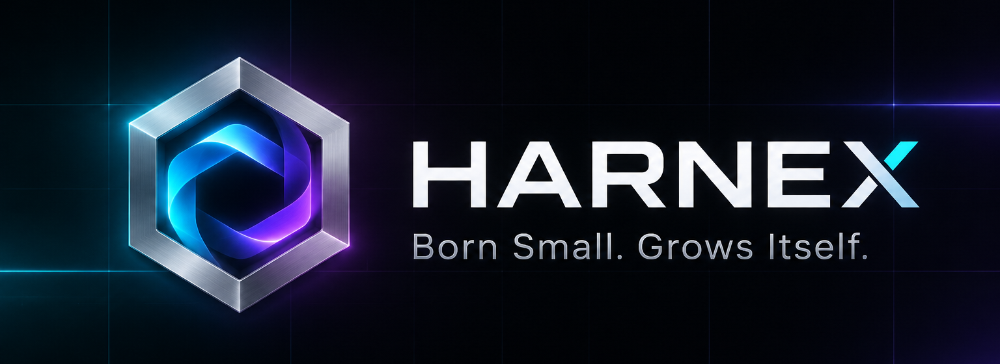
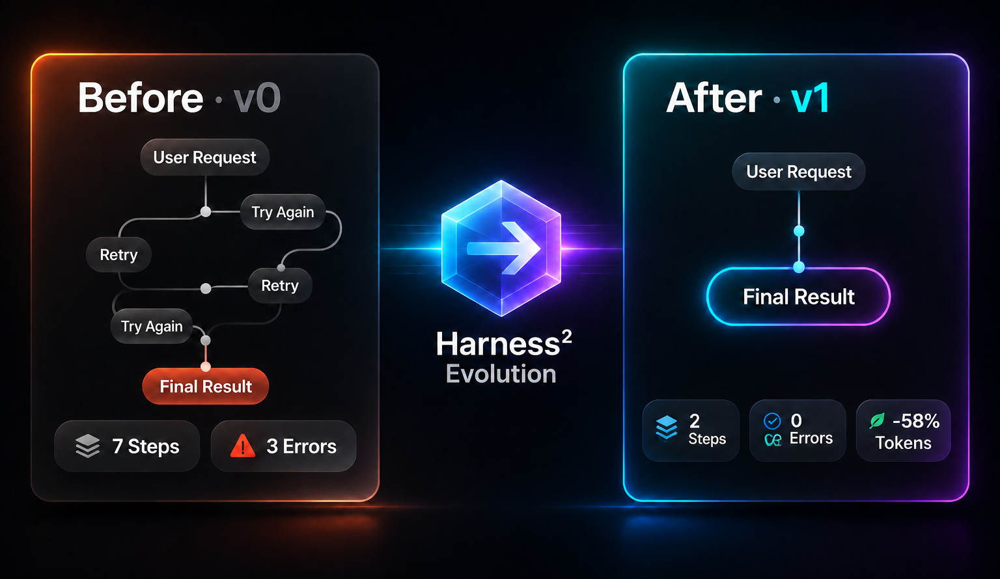
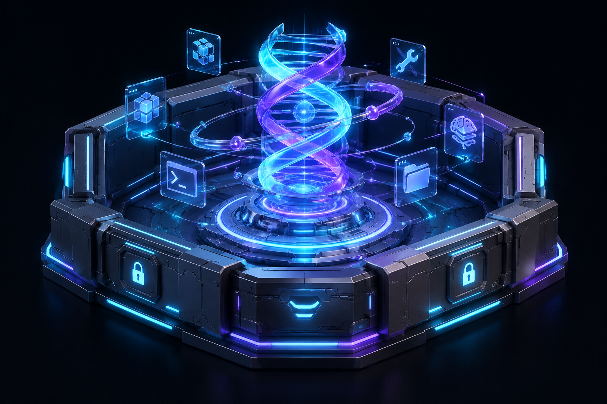
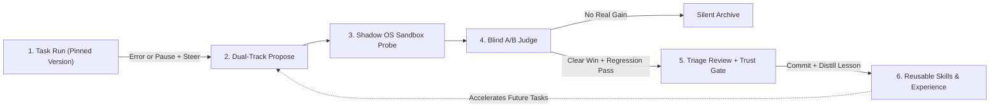

  

<h1>The Self-Evolving Desktop AI Agent.</h1>

  <strong>Stop rewriting prompts. Correct Harnex once—it writes its own tools, proves them in an OS sandbox, and beats its past self on the exact same model.</strong>

  
  
  
  
  

  <strong>English</strong> ·
  <a href="README.zh-CN.md">简体中文</a> ·
  <a href="docs/ARCHITECTURE.md">Architecture Deep Dive</a> ·
  <a href="docs/EVOLUTION_BLUEPRINTS.md">V2+ Open Blueprints</a>

> **V1.0 Active Launch Build**: Harnex is in active V1.0 engineering build—this repository showcases our product vision, visual architecture, and open V2+ blueprints ahead of the first release binaries. **Star the repo** to follow the launch or jump into **Discussions** to vote on what ships next!

---

## The 60-Second Proof: An Agent That Actually Outgrows Its Mistakes

  

Most desktop AI agents are **amnesiacs**. When an agent trips over messy local files, encoding quirks, or your personal workflow, it makes the exact same mistake next week—unless *you* manually edit its system prompts or hunt for plugins.

**Harnex evolves on the job, without changing model weights:**

1. **You hit a real snag**: You ask Harnex `v0` to parse messy multi-encoding desktop billing CSVs. It stumbles (`7 steps · 3 errors`), or you hit **Pause** once mid-run to point it in the right direction.
2. **Harnex evolves in the background**: Powered by Google Research's **Harness²** dual-layer recursion, Harnex diagnoses what went wrong, **writes its own reusable TypeScript parser script**, tests it inside an isolated Copy-on-Write shadow workspace, and runs an **anonymous A/B blind judge** (`v0` vs. `v1`) to verify a real win—no ground-truth answer key required.
3. **Unseen tasks fly**: Once approved into your versioned genome, the **exact same model** walks up to a brand-new unseen folder (`dataset_b`) and finishes in **2 steps · 0 errors · 58% fewer tokens**.

| What You Experience | Ordinary Desktop Agents | ⚡ Harnex |
| :--- | :--- | :--- |
| **Out of the Box** | Bloated static prompts & pre-packed plugin clutter | **Clean, tiny seed** — grows only the skills your desktop actually needs |
| **When Things Break** | Repeats the same error until you rewrite prompts | **Writes its own fix** — scripts, guidance & lessons verified in a shadow copy |
| **During Execution** | Watch helplessly or kill the chat and start over | **Pause → Steer → Evolve** — one mid-run correction trains the next version |
| **Trust & Safety** | Scripts share your full user permissions & prompt injection sticks | **4-Layer Rust Vault** — real OS sandbox, SHA-256 hooks, isolated safety reviewer |
| **Upgrade Risk** | Prompt tweaks silently break things that used to work | **Git Time-Travel** — diff every evolution, replay `v0` vs `v1`, auto-revert regressions |

---

## Meet the Command Deck

  

 

<table>
  <tr>
    <td width="50%" valign="top">
      <h3>⏸ Pause Mid-Run. Teach It Once.</h3>
      Notice the agent drifting off course? Hit <strong>Pause</strong>, type a quick course correction, and hit <strong>Resume</strong>. Harnex finishes your task immediately—and automatically queues your steer as a high-signal training cue for background evolution.
    </td>
    <td width="50%" valign="top">
      <h3>🔬 Live Evolution Theater — Zero Black-Box Magic</h3>
      Watch proposals form in real time, see agent-authored scripts verified inside a shadow copy, and inspect the shuffled <strong>Blind Judge A/B</strong> verdict. Want to tweak an evolved script? Leave an <strong>inline comment on any Diff line</strong> to trigger targeted re-evolution.
    </td>
  </tr>
  <tr>
    <td width="50%" valign="top">
      <h3>⏪ Git Time-Travel & Shareable Agent Genomes</h3>
      Every evolution is an atomic commit managed by embedded <code>libgit2</code>. Replay any past task on <code>v0</code> vs <code>v1</code> using the exact same model to see the leap, roll back in one click, or export a secret-scanned genome pack to share with the community.
    </td>
    <td width="50%" valign="top">
      <h3>🔌 Bring Your Own Models in 10 Seconds</h3>
      Assign different models to <strong>Solver</strong> (fast), <strong>Improver</strong> (reasoning), and <strong>Judge</strong> slots across OpenAI-compatible, Anthropic, Gemini, DeepSeek, or local Ollama—or import existing providers in one click from <strong>CC Switch</strong> & <strong>Magpie</strong>.
    </td>
  </tr>
</table>

---

## Built Like a Vault: Why You Can Trust It on Your Real Desktop

  

Giving an AI agent the ability to evolve itself sounds scary—until you lock the execution floor in Rust. Harnex keeps the agent's brain adaptable while locking every real-world side effect inside a **4-layer Codex-inspired security vault**:

1. **Real OS-Level Sandbox (`macOS Seatbelt` / `Linux bubblewrap & Landlock`)**: Every file write, shell command, and agent-authored script runs inside a real OS sandbox enforced by Rust—physically blocked from touching your SSH keys, system files, or Harnex's own security rules.
2. **Smart Trust — Zero Alert Fatigue**: MCP servers you install work seamlessly without popups. Hooks require one-time trust and are fingerprinted with **SHA-256** (if a hook ever changes by even 1 byte, trust invalidates immediately).
3. **Isolated Safety Reviewer (`auto` mode)**: An independent Guardian AI reviews risky commands in a clean context that *never* sees untrusted web pages or external files—shutting down prompt injection. Core instructions and executable code *always* require your explicit trust before taking effect.
4. **System Keychain, Spend Limits & Auto-Rollback**: API keys stay exclusively in your OS native keychain; daily spending enforces a hard Rust circuit breaker; if a new evolved version ever degrades success rates, embedded `libgit2` automatically rolls back to the last healthy version.

### How the Self-Evolution Loop Works

> Curious about the deep engineering details (`L0/L1/L2` boundaries, `BUN_BE_BUN=1` single-binary sandboxing, snapshot pinning, and minimum model specs)? Read the full [Architecture Deep Dive](docs/ARCHITECTURE.md).

---

## Honest 3-Minute First-Run Experience & Platform Support

No blank chat box on launch, and no fake magic:
- **🎬 Recorded Replay Mode (Default, Zero API Key)**: Launch Harnex and immediately watch a real pre-recorded `v0 → v1` evolution on messy multi-encoding desktop files—transparently labeled as a recorded trace.
- **⚡ Live Evolution Mode (After Adding Your Key)**: See estimated runtime and token cost up front, then run live self-evolution across `dataset_a` and unseen `dataset_b` using your own model provider.

| Platform | Support Tier | OS Sandbox Mechanism | Keyring Storage |
| :--- | :--- | :--- | :--- |
| **macOS** | **Full Support** | Seatbelt (`sandbox-exec`) | macOS Keychain |
| **Linux** | **Full Support** | `bubblewrap` / `Landlock` | Secret Service (D-Bus) |
| **Windows** | **Beta** | Job Object + Restricted Token + Path Canonicalization *(narrower FS isolation than POSIX)* | Windows Credential Manager |

---

## Born Small, Co-Created Openly

Harnex V1.0 stays lean and auditable on purpose. Rather than bloating the core with guesswork features, we publish 6 open blueprints in [docs/EVOLUTION_BLUEPRINTS.md](docs/EVOLUTION_BLUEPRINTS.md) for community voting and self-evolved contributions:

1. **Hierarchical & Vector Memory** — tiered compaction & local SQLite semantic retrieval
2. **Community Hook Registry** — curated safety, PII-redaction & auto-fix hooks with test fixtures
3. **Skills Lifecycle Engine** — cross-domain pattern mining, semantic deduplication & pruning
4. **Multi-Subagent Orchestration** — specialist worker swarms & live DAG execution trees
5. **MCP Ops Console & Templates** — graphical diagnostics, OAuth helpers & office bundles
6. **Monotonic Sandbox Packs & `views/` Host** — domain hardening rules & sandboxed interactive cards

> **Vote or Evolve Together**: Star **Harnex**, vote in **GitHub Discussions**, or feed a blueprint to your own Harnex instance and open a PR with its self-evolved solution!

---

## License & Attribution

Licensed under the [Apache License 2.0](LICENSE).
Dual-layer recursive agent harnessing core is derived from [`google-research/harness2`](https://github.com/google-research/harness2) (Copyright 2026 Google LLC, Apache-2.0). See [NOTICE](NOTICE) for full attribution.
