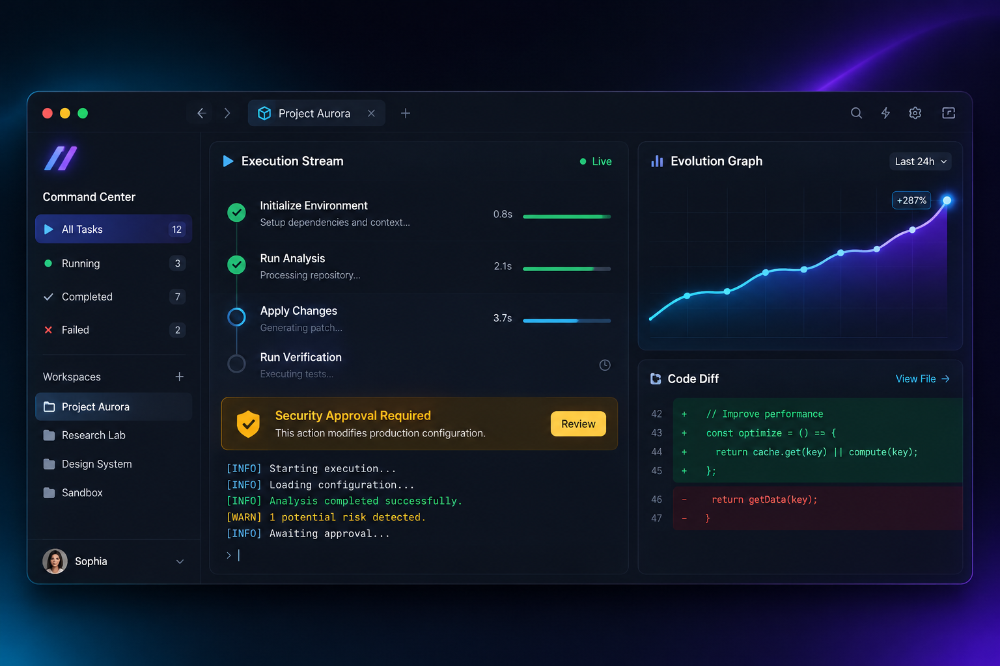
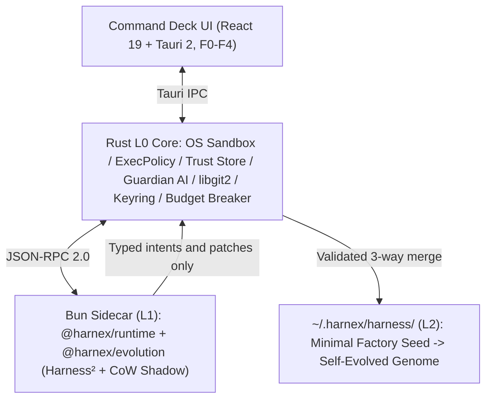
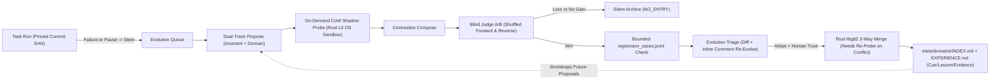

  

<h3>A minimal immutable desktop shell with a self-evolving Harness² core — born small, grows itself.</h3>

  
  
  
  
  

  <strong>English</strong> ·
  <a href="README.zh-CN.md">简体中文</a> ·
  <a href="docs/ARCHITECTURE.md">Architecture & Security</a> ·
  <a href="docs/EVOLUTION_BLUEPRINTS.md">V2+ Open Blueprints</a>

> **Status — V1.0 Active Development**: Harnex is currently in active V1.0 engineering build. This repository publishes the project overview, brand visuals, security architecture, and open V2+ blueprints ahead of the initial source & binary release. Star the repo or join **Discussions** to help shape V2+ priorities!

---

## Why Harnex?

Most desktop AI agents ship with bloated static prompts, brittle plugin trees, and no way to learn from mistakes on *your* machine. **Harnex** flips the paradigm: it starts with a tiny, clean factory seed (`harness-seed/`) wrapped inside an **immutable Rust L0 security shell**, and recursively evolves its own tools, scripts, skills, and domain experience from real failures and human mid-run corrections (**Pause → Steer → Evolve**).

| Dimension | Static Desktop Agents | ⚡ Harnex |
| :--- | :--- | :--- |
| **Starting Footprint** | Heavy static prompts & pre-bundled plugin bloat | **Minimal clean seed** — grows only what your workflows actually need |
| **Self-Improvement** | Manual prompt editing when workflows fail | **Harness² Dual-Layer RSI** — proposes, probes, blind-judges, and distills verified lessons |
| **Security Boundary** | In-process JS/Python tools or regex blacklists | **Rust L0 4-Layer Defense** — OS physical sandbox (`BUN_BE_BUN=1`), SHA-256 Trust Store, isolated Guardian AI |
| **Version Safety** | Unaudited prompt drift & silent regressions | **Embedded `libgit2` Genome Repo** — snapshot-pinned threads, 3-way merge, automatic `auto`-mode health rollback |
| **First-Run Experience** | Blank chat box requiring immediate setup | **Dual-Mode Crucible** — zero-key recorded `v0 → v1` replay + live evolution once you connect a provider |

---

## The Living Agent Command Deck

  

 

<table>
  <tr>
    <td width="50%" valign="top">
      <h3>⏸ Pause → Steer → Evolve</h3>
      Interrupt any running thread mid-flight to steer its direction and resume. Harnex automatically tags your mid-run correction as a high-value negative signal and queues background Harness² evolution as soon as the task finishes.
    </td>
    <td width="50%" valign="top">
      <h3>🔬 Evolution Theater & Blind Judge A/B</h3>
      Watch Invariant + Domain proposals probe inside an isolated Copy-on-Write shadow workspace. Forward/reverse shuffled blind evaluation eliminates judge bias, <code>NO_ENTRY</code> filters noise, and inline Diff comments trigger targeted re-evolution.
    </td>
  </tr>
  <tr>
    <td width="50%" valign="top">
      <h3>🧬 Genome Deck & v0 / v1 Replay</h3>
      Explore your <code>~/.harnex/harness/</code> Git timeline powered by embedded <code>libgit2</code>. Compare cross-generation runs on the exact same solver model, roll back in one click, or export secret-scanned genome packs (imports start untrusted).
    </td>
    <td width="50%" valign="top">
      <h3>🔌 Multi-Slot & One-Click Provider Import</h3>
      Assign distinct models to <strong>Solver</strong>, <strong>Improver</strong>, and <strong>Judge</strong> slots. Add OpenAI-compatible, Anthropic, Gemini, or Ollama endpoints manually—or import existing configs read-only from <strong>CC Switch</strong> & local <strong>Magpie</strong> gateways (keys live strictly in your OS native keyring).
    </td>
  </tr>
</table>

---

## Immutable Rust L0 + Harness² Architecture

  

### Three-Layer Separation (L0 / L1 / L2)

> **Core Security Invariant**: The TypeScript Sidecar (L1) **never** writes files, runs shell commands, executes self-authored scripts/hooks, or commits to Git directly. Every side effect is emitted as a typed intent and executed by **Rust L0** inside an OS-level sandbox.

### Codex-Style 4-Layer Security Defense

| Layer | Rust L0 Component | Enforcement & Trust Guarantee |
| :--- | :--- | :--- |
| **1. OS Physical Sandbox** | `sandbox_os.rs` + `executor.rs` | Default `workspace-write` containment; physically blocks `.git/`, `~/.harnex/harness/`, `~/.ssh/`, `trust.json`, and system paths. Agent-authored `scripts/*.ts` & `hooks/*.ts` run via embedded `BUN_BE_BUN=1` **inside** the OS sandbox. |
| **2. ExecPolicy & SHA-256 Trust Store** | `security.rs` (`~/.harnex/trust.json`) | Deterministic command rules (`allow` / `prompt` / `forbidden`). **User-installed MCP servers are trusted by default** (zero prompt friction); `hooks/*.ts` use **Trust-on-First-Use + SHA-256** (a 1-byte change invalidates trust and forces re-approval). |
| **3. Isolated Guardian AI (`auto` mode)** | `guardian.rs` | Evaluates out-of-policy commands in a sanitized context (`sanitizedInputOnly: true` — web pages & dirty files are strictly excluded to prevent prompt injection). High-privilege harness edits (`scripts/`, `hooks/`, `mcp/servers.json`, `systemprompt.md`, `guardrails.md`) **always require human trust**, even in `auto` mode. |
| **4. Embedded `libgit2`, Keyring & Spend Breaker** | `git_store.rs`, `keyring.rs`, `budget.rs` | Single Git writer (no system `git` needed); foreground threads pin a Commit SHA; `auto`-mode health circuit breaker auto-reverts degraded evolutions; API keys stay exclusively in OS native keyrings; Rust enforces hard daily USD/token caps. |

### Harness² Dual-Layer Recursion Engine

Derived from [`google-research/harness2`](https://github.com/google-research/harness2) (*Recursive Agent Harnessing for an Open World*):

---

## Honest Dual-Mode First-Run Crucible

No empty chat box and no fake magic:
- **🎬 Recorded Replay Mode (Default, No API Key Required)**: Immediately step through a real pre-recorded `v0 → v1` evolution on messy multi-encoding desktop CSVs (`GB18030` + `UTF-8 BOM`), transparently labeled as a recorded trace.
- **⚡ Live Evolution Mode (After Connecting a Provider)**: Discloses estimated runtime and token cost up front, then runs live Harness² evolution across `dataset_a` (training challenge) and unseen `dataset_b` (verification) — proving how the *same* Solver model leaps forward through harness evolution alone.

---

## Platform Support Matrix

| OS | Support Tier | OS Sandbox Backend | Keyring Backend |
| :--- | :--- | :--- | :--- |
| **macOS** | **Full Support** | Seatbelt (`sandbox-exec`) | macOS Keychain |
| **Linux** | **Full Support** | `bubblewrap` / `Landlock` | Secret Service (D-Bus) |
| **Windows** | **Beta** | Job Object + Restricted Token + Rust Path Canonicalization *(narrower FS isolation than POSIX)* | Windows Credential Manager |

See [docs/ARCHITECTURE.md](docs/ARCHITECTURE.md) for detailed security invariants, minimum model recommendations, and full Windows Beta disclosure.

---

## Open Co-Creation: V2+ Evolution Blueprints

Harnex ships **V1.0** lean and auditable—instead of over-engineering unvalidated subsystems behind closed doors, we publish 6 open blueprints in [docs/EVOLUTION_BLUEPRINTS.md](docs/EVOLUTION_BLUEPRINTS.md):

1. **Hierarchical & Vector Memory** — tiered compaction & local SQLite vector retrieval
2. **Community Hook Registry** — curated guard, PII-redaction & auto-fix hooks with SHA-256 fixtures
3. **Skills Lifecycle Engine** — cross-domain pattern mining, semantic deduplication & pruning
4. **Multi-Subagent Orchestration** — parallel specialist swarms & live DAG execution trees
5. **MCP Ops Console & Templates** — graphical MCP diagnostics, OAuth helpers & office bundles
6. **Monotonic Sandbox Packs & `views/` Host** — domain hardening packs & sandboxed interactive UI cards

> **Vote or Evolve Together**: Join **GitHub Discussions** to vote on which Blueprint ships next—or feed a blueprint straight to your local Harnex instance and submit its self-evolved output (with `BlindJudgeResult` & eval deltas) as a PR!

---

## License & Attribution

Licensed under the [Apache License 2.0](LICENSE).
Core dual-layer recursive agent harnessing architecture is derived from [`google-research/harness2`](https://github.com/google-research/harness2) (Copyright 2026 Google LLC, Apache-2.0). See [NOTICE](NOTICE) for full attribution.
