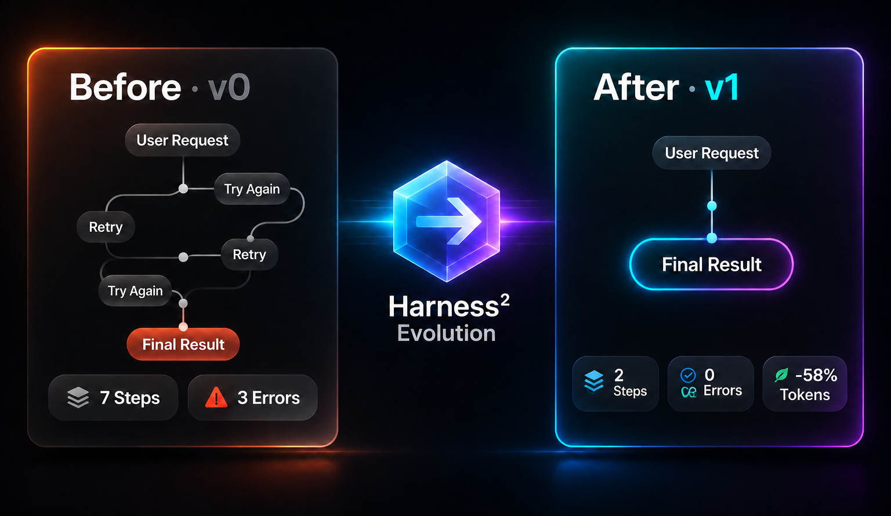
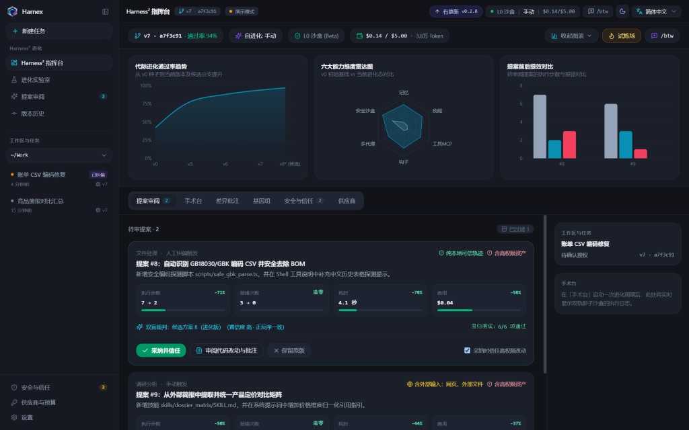
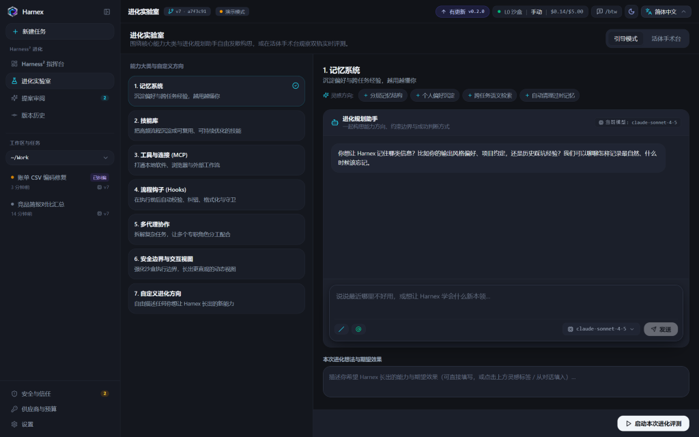
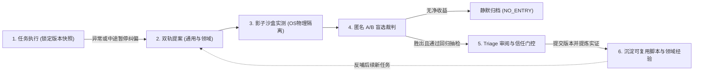

  

<h1>自主演进的桌面 AI Agent</h1>

  <strong>告别反复手调 Prompt。只需一次中途纠偏，Harnex 便会在系统沙盒中自主构建工具、完成匿名 A/B 盲测并版本化沉淀——同一款模型，持续进化。</strong>

  
  
  
  
  

  <a href="README.md">English</a> ·
  <strong>简体中文</strong> ·
  <a href="docs/ARCHITECTURE.md">架构与安全白皮书</a> ·
  <a href="docs/EVOLUTION_BLUEPRINTS.md">V2+ 开放共创蓝图</a>

> **V1.0 开源发布冲刺中**：Harnex 桌面指挥台（Command Deck）已在本地运行（下方为真实软件界面截图），核心工程源码与桌面安装包正在进行最终合龙，即将正式推送上线。欢迎点亮 **Star** 抢先关注，或前往 **Discussions** 参与 V2+ 开放蓝图投票！

---

## 一次纠偏，持续演进

  

传统桌面 AI Agent 在发布那一刻便已固化——当它面对本地异构文件格式、编码偏差或特定业务流而反复试错时，下一次依然会重蹈覆辙，除非人工重写系统提示词或四处检索插件。

**Harnex 在保持底层模型权重完全不变的前提下，实现运行环境的自主递归演进：**

1. **捕获真实阻塞与人工纠偏**：出厂种子 `v0` 在解析混合编码（`GB18030` / `UTF-8 BOM`）桌面账单时遭遇多次重试（`7 步 · 3 次报错`），或由你在执行中途点击 **暂停（Pause）** 给出方向修正。
2. **后台沙盒验证与匿名盲选**：基于 Google Research **Harness²** 双层递归架构，后台引擎分析对比执行轨迹，**自主编写可复用的 TypeScript 解析脚本**，在按需 Copy-on-Write 影子沙盒中完成零报错实测，并经**正反序匿名 A/B 盲选裁判**严格验优——全程无需预设标准答案。
3. **未见任务稳定跃迁**：经你确认合入基因版本库后，**完全相同的模型**在面对从未见过的新目录（`dataset_b`）时，直接调用自主沉淀的工具与经验，以 **2 步 · 0 报错 · 节省 58% Token** 一次收敛。

| 核心体验对比 | 传统静态桌面 Agent | ⚡ Harnex |
| :--- | :--- | :--- |
| **初始形态** | 预置臃肿静态提示词与冗余插件 | **极简出厂种子** —— 仅围绕你的真实工作流按需生长 |
| **故障与纠错** | 重复相同错误，依赖人工修改配置 | **自主生成修复方案** —— 脚本、工具指南与经验经沙盒实测后沉淀 |
| **执行控制** | 失控时只能中断会话重来 | **暂停纠偏即进化（Pause → Steer → Evolve）** —— 一次介入触发后台定向进化 |
| **系统安全** | 脚本直接运行于宿主权限，易受注入持久化影响 | **Rust 四层纵深隔离** —— OS 物理沙盒、Hook SHA-256 指纹锁、隔离式 Guardian 审查 |
| **迭代可靠性** | 修改 Prompt 易引发已有能力隐性退化 | **Git 版本化基线** —— 全量 Diff 审阅、`v0 / v1` 同模型回放、异常自动回滚 |

---

## 桌面指挥台 · Command Deck

  

 

### Evolution Lab 进化实验室 — 能力大类规划与交互式进化控制台

  

 

<table>
  <tr>
    <td width="50%" valign="top">
      <h3>⏸ 随时介入，一次纠偏即进化</h3>
      察觉执行路径偏离预期时，可随时点击 <strong>暂停（Pause）</strong> 输入修正指令并继续执行。前台任务无缝完成的同时，该次人工纠偏会被自动标记为高价值信号，驱动后台 Harness² 定向演进。
    </td>
    <td width="50%" valign="top">
      <h3>🔬 透明演进现场，拒绝黑盒</h3>
      在进化手术台实时查看双轨提案、影子沙盒试跑指标变化（步数、报错、耗时、Token）以及匿名 <strong>Blind Judge A/B</strong> 裁判推理；对进化出的代码细节有更优想法时，可直接在 <strong>Diff 任意行留批注</strong>触发定向复进化。
    </td>
  </tr>
  <tr>
    <td width="50%" valign="top">
      <h3>⏪ Git 版本时光机与可分享基因库</h3>
      每一次演进均由内嵌 <code>libgit2</code> 原子化提交至本地版本库。支持在同一模型上回放对比 <code>v0 vs v1</code> 的真实表现、一键回滚任意历史版本，或经密钥与隐私扫描后导出脱敏基因包（导入第三方基因默认处于未信任禁用态）。
    </td>
    <td width="50%" valign="top">
      <h3>🔌 多模型槽位与一键配置迁移</h3>
      为 <strong>执行（Solver）</strong>、<strong>进化（Improver）</strong> 与 <strong>裁判（Judge）</strong> 分别绑定最适合的模型（支持 OpenAI 兼容 / Anthropic / Gemini / DeepSeek / Ollama），并支持从 <strong>CC Switch</strong> 与本地 <strong>Magpie</strong> 网关一键只读导入既有配置。
    </td>
  </tr>
</table>

---

## Rust 原生安全架构：为真实桌面而生

  

自主进化能力的前提是绝对可控的执行边界。Harnex 将核心推理与策略演进留给 TypeScript 引擎，而将所有真实世界的文件写入、命令执行与版本落盘下沉锁入 **Rust 四层纵深安全架构**：

1. **操作系统级物理沙盒（`macOS Seatbelt` / `Linux bubblewrap & Landlock`）**：所有文件写入、终端命令以及 Agent 自主编写的脚本均由 Rust 在操作系统物理沙盒内拉起执行——物理隔离 SSH 密钥、系统关键目录及 Harnex 自身安全配置。
2. **精细化信任模型（MCP 默认信任 · Hook SHA-256 指纹校验）**：用户手动安装的 MCP 服务默认信任、零弹窗调用；Hook 脚本采用首次信任（TOFU）与 SHA-256 指纹锁，未修改时无缝放行，哪怕变更 1 个字节立即失效并重新确认。
3. **上下文隔离的安全审查（`auto` 模式 Guardian AI）**：全自动模式下，越界或高风险命令交由独立的 Guardian AI 在屏蔽网页与外部不可信文件的洁净上下文中审查，阻断提示词注入；涉及核心指令、脚本、Hook 与 MCP 配置的高权进化变更，**始终要求人类显式信任确认**。
4. **系统钥匙串、费用硬熔断与异常自动回滚**：API 密钥全部存管于系统原生钥匙串；Rust 强制执行每日花费硬上限；内嵌 `libgit2` 持续监控各领域健康度，一旦新版本导致成功率显著恶化，自动回滚至上一个健康版本。

### 双层递归进化闭环

> 欲了解 `L0/L1/L2` 三层权限边界、`BUN_BE_BUN=1` 单文件脚本沙盒、多线程版本锁定及最低模型配置建议，请参阅完整 [架构与安全白皮书](docs/ARCHITECTURE.md)。

---

## 双模式初次体验与平台支持

告别空白聊天框冷启动，也拒绝不可控的黑盒演示：
- **🎬 录制回放模式（默认，免 API Key）**：首次打开即可流畅浏览一次真实录制的 `v0 → v1` 完整进化轨迹（明确标注为录制回放），直观理解 Harnex 的演进全流程。
- **⚡ 实时进化模式（接入供应商后开启）**：界面透明预估运行耗时与 Token 成本，可在 `dataset_a` 演练集与未见验证集 `dataset_b` 上真实跑通完整自主进化闭环。

| 操作系统 | 支持级别 | OS 沙盒机制 | 钥匙串存储 |
| :--- | :--- | :--- | :--- |
| **macOS** | **完整支持** | Seatbelt (`sandbox-exec`) | macOS Keychain |
| **Linux** | **完整支持** | `bubblewrap` / `Landlock` | Secret Service (D-Bus) |
| **Windows** | **Beta** | Job Object + 受限令牌 + 路径规范化 *(文件系统隔离粒度较 POSIX 弱，详见白皮书说明)* | Windows Credential Manager |

---

## 极简内核，开放共创

Harnex V1.0 坚持精简、可控、可审计的内核设计，不在早期闭门堆砌重型子系统；我们在 [docs/EVOLUTION_BLUEPRINTS.md](docs/EVOLUTION_BLUEPRINTS.md) 公开了 6 大开放进化蓝图，由社区共同决定后续演进优先级：

1. **分层与向量记忆系统** —— 自动遗忘压缩与本地 SQLite 语义/图谱检索
2. **社区 Hook 共享生态** —— 标准化防错、隐私脱敏与自动格式化钩子库
3. **Skills 生命周期引擎** —— 跨领域模式挖掘、语义去重、合并升级与失效淘汰
4. **多子代理并行协同** —— 专职角色模板包与 DAG 并行执行树
5. **MCP 运维台与办公模板** —— 图形化状态诊断、OAuth 助手与常见桌面工具套件
6. **进阶沙盒规则包与 `views/` 动态视图** —— 单调加固安全策略与受限 L2 交互卡片

> **参与投票或提交自进化 PR**：点亮 **Star** 关注项目，在 **GitHub Discussions** 为你最期待的蓝图投票；或者将蓝图交付本地 Harnex 自主演进，附带盲选对比与评测数据提交 PR！

---

## 开源协议与致谢

本项目基于 [Apache License 2.0](LICENSE) 开源。
核心双层递归进化引擎架构衍生自 Google Research 的 [`google-research/harness2`](https://github.com/google-research/harness2)（Copyright 2026 Google LLC, Apache-2.0），详见 [NOTICE](NOTICE)。
