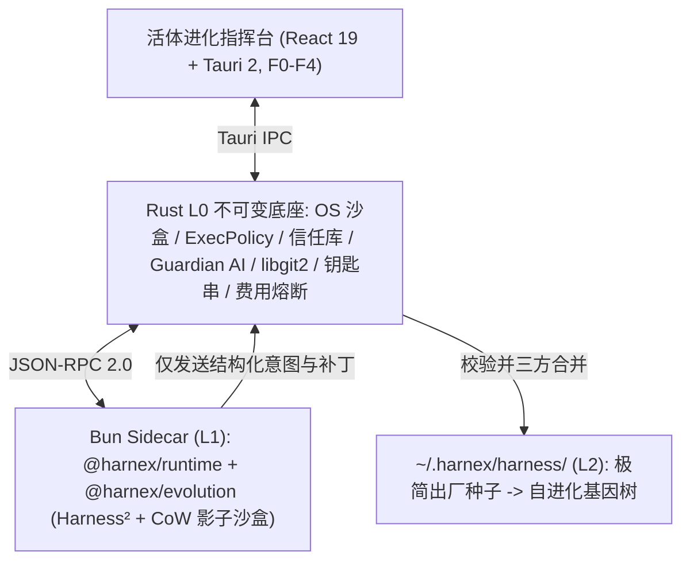
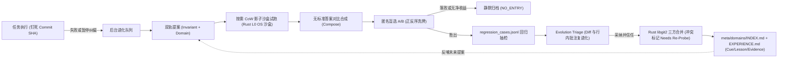

  

<h3>极简不可变安全桌面外壳 + 指数级自进化 Harness² 内核 —— 出厂极小，自我生长。</h3>

  
  
  
  
  

  <a href="README.md">English</a> ·
  <strong>简体中文</strong> ·
  <a href="docs/ARCHITECTURE.md">架构与安全白皮书</a> ·
  <a href="docs/EVOLUTION_BLUEPRINTS.md">V2+ 开放共创蓝图</a>

> **开发状态说明（V1.0 研发中）**：Harnex 目前正处于 V1.0 核心工程建设期。本仓库率先公开项目愿景、品牌视觉、四层安全架构设计及 V2+ 开放共创蓝图；代码合龙后将第一时间发布首个可用桌面安装包。欢迎点亮 **Star** 或在 **Discussions** 参与讨论！

---

## 为什么选择 Harnex？

绝大多数桌面 AI Agent 出厂即塞满臃肿的静态提示词与易冲突的插件树，且永远无法从你电脑上的真实踩坑中长记性。**Harnex** 反其道而行之：从极其轻薄干净的出厂种子（`harness-seed/`）出发，将其锁进**不可变 Rust L0 四层安全底座**，并在真实任务的失败与人类中途纠偏（**Pause → Steer → Evolve**）中，自己造出工具脚本、沉淀 Skills 与分领域经验库。

| 对比维度 | 传统静态桌面 Agent | ⚡ Harnex |
| :--- | :--- | :--- |
| **出厂体积与初始复杂度** | 静态 Prompt 臃肿、预装海量冗余插件 | **极简干净出厂种子** —— 按你的真实桌面工作流按需生长 |
| **自我改进能力** | 踩坑只能人工改 Prompt 或到处找插件 | **Harness² 双层递归 RSI** —— 自动双轨提案、沙盒试跑、盲选判胜、经验沉淀 |
| **安全执行边界** | 依赖同进程脚本或易被绕过的正则黑名单 | **Rust L0 四层纵深防御** —— OS 物理沙盒（`BUN_BE_BUN=1`）、SHA-256 信任库、独立无污染 Guardian AI |
| **并发与版本稳定性** | 越改越乱、并发任务撕裂、无可靠回滚 | **内嵌 `libgit2` 基因库** —— 线程钉死 Commit SHA、三方合并、`auto` 模式健康恶化自动熔断回滚 |
| **首次启动体验** | 空白聊天框冷启动，无从下手 | **双模式首启试炼场** —— 免 Key 直接观看真实录制回放，配好供应商即跑实时活体进化 |

---

## 活体进化指挥台（Living Agent Command Deck）

  

 

<table>
  <tr>
    <td width="50%" valign="top">
      <h3>⏸ 暂停纠偏即进化（Pause → Steer → Evolve）</h3>
      任务执行中随时点击暂停并输入纠偏方向继续执行。Harnex 会自动将你的中途介入标记为高价值进化信号，任务结束后立即送入后台 Harness² 进化队列。
    </td>
    <td width="50%" valign="top">
      <h3>🔬 进化手术台与盲选竞技场（Blind Judge A/B）</h3>
      在按需 Copy-on-Write 影子沙盒中同时试跑通用与领域双轨提案；固定种子正反序盲选消除偏置，<code>NO_ENTRY</code> 自动过滤无效噪声；支持在 Diff 任意行直接留批注触发定向复进化。
    </td>
  </tr>
  <tr>
    <td width="50%" valign="top">
      <h3>🧬 基因演化轴与 v0 / v1 跨代回放</h3>
      基于内嵌 <code>libgit2</code> 直观浏览 <code>~/.harnex/harness/</code> 演化历史。用完全相同的 Solver 模型对比重跑 <code>v0 vs v1</code>，一键回滚，或经密钥/PII 扫描后导出脱敏基因包（导入第三方基因默认未信任禁用）。
    </td>
    <td width="50%" valign="top">
      <h3>🔌 三槽位路由与一键导入供应商</h3>
      分别为 <strong>Solver</strong>、<strong>Improver</strong>、<strong>Judge</strong> 配置独立模型。支持手动添加 OpenAI 兼容 / Anthropic / Gemini / Ollama，或一键只读导入 <strong>CC Switch</strong> 与本地 <strong>Magpie</strong> 网关（密钥全部存入系统原生钥匙串）。
    </td>
  </tr>
</table>

---

## 不可变 Rust L0 安全壳 + Harness² 双层架构

  

### 三层权限隔离（L0 / L1 / L2）

> **核心安全铁律**：TypeScript Sidecar（L1）**绝不**直接写文件、执行 Shell、跑自造脚本或操作 Git。所有副作用均封装为强类型意图，下沉交由 **Rust L0** 在操作系统物理沙盒内校验执行。

### 对标 Codex 的四层纵深安全防御

| 防御层级 | Rust L0 模块 | 安全保障与信任规则 |
| :--- | :--- | :--- |
| **1. OS 级物理沙盒** | `sandbox_os.rs` + `executor.rs` | 默认 `workspace-write` 隔离；物理禁止写入 `.git/`、`~/.harnex/harness/`、`~/.ssh/`、`trust.json` 与系统关键目录。Agent 自造 `scripts/*.ts` 与 `hooks/*.ts` 由 Rust 在 OS 沙盒内拉起内嵌 `BUN_BE_BUN=1` 执行，彻底封堵 Bun 无权限模型漏洞。 |
| **2. ExecPolicy 与 SHA-256 信任库** | `security.rs` (`~/.harnex/trust.json`) | 确定性命令前缀规则（`allow` / `prompt` / `forbidden`）。**用户主动安装的 MCP 默认信任**（零弹窗直接执行）；`hooks/*.ts` 采用**首次信任 + SHA-256 校验**（文件改动哪怕 1 个字节立刻失效并触发重新授权）。 |
| **3. 独立无污染 Guardian AI（`auto` 模式）** | `guardian.rs` | 仅接收脱敏命令上下文（`sanitizedInputOnly: true`，严禁注入网页与外部脏文件防注入攻击）。高权 Harness 资产（`scripts/`、`hooks/`、`mcp/servers.json`、`systemprompt.md`、`guardrails.md`）即便在 `auto` 模式下也**必须经人类首次信任确认**。 |
| **4. 内嵌 `libgit2`、原生钥匙串与费用熔断** | `git_store.rs`、`keyring.rs`、`budget.rs` | 零依赖系统 `git` 的唯一 Git 写入者；前台线程钉死 Commit SHA；`auto` 模式支持量化健康自动回滚；API Key 统一存入系统钥匙串；Rust 强制执行每日费用/Token 硬上限。 |

### Harness² 双层递归自进化引擎

架构衍生自 Google Research [`google-research/harness2`](https://github.com/google-research/harness2)（*Recursive Agent Harnessing for an Open World*）：

---

## 首启双模式试炼场（不造假、零门槛）

拒绝空白聊天框冷启动与不可控的“黑盒演示”：
- **🎬 录制回放模式（默认，无需 API Key）**：首次打开即可零门槛完整观看一次真实录制的 `dataset_a`（`GB18030` + `UTF-8 BOM` 乱码账单）`v0 → v1` 进化回放，界面明确标示为录制轨迹。
- **⚡ 实时进化模式（配置供应商后开启）**：界面透明预估耗时与 Token 费用，可在 `dataset_a` 与未见验证集 `dataset_b` 上真实跑通“翻车 → 手术台自造工具 → 沙盒零报错盲选胜出 → 未见数据秒过”的完整闭环。

---

## 平台支持矩阵

| 操作系统 | 支持级别 | OS 沙盒后端 | 钥匙串后端 |
| :--- | :--- | :--- | :--- |
| **macOS** | **完整支持** | Seatbelt (`sandbox-exec`) | macOS Keychain |
| **Linux** | **完整支持** | `bubblewrap` / `Landlock` | Secret Service (D-Bus) |
| **Windows** | **Beta 支持** | Job Object + 受限令牌 + Rust 路径规范化 *(文件系统隔离范围较 POSIX 沙盒弱)* | Windows Credential Manager |

完整安全边界、最低模型能力建议及 Windows Beta 差异披露请参阅 [docs/ARCHITECTURE.md](docs/ARCHITECTURE.md)。

---

## V2+ 开放共创蓝图（Open Blueprints）

**Harnex V1.0** 坚持极简、可审计的种子内核，不闭门造车堆砌重型业务；我们在 [docs/EVOLUTION_BLUEPRINTS.md](docs/EVOLUTION_BLUEPRINTS.md) 公开了 6 大进阶演进蓝图：

1. **进阶记忆体系** —— 分层记忆压缩与本地 SQLite 向量/图谱检索
2. **社区 Hook 共享库** —— 标准化防错、隐私脱敏与自动格式化 Hook 集
3. **Skills 生命周期引擎** —— 跨领域模式挖掘、语义去重、合并升级与失效淘汰
4. **多子代理协同编排** —— 专职角色模板包与 DAG 并行任务树
5. **MCP 运维台与办公模板** —— 图形化诊断、OAuth 助手与开箱即用办公工具包
6. **进阶沙盒规则包与 `views/` 动态视图** —— 单调加固安全策略与受限 L2 交互卡片生态

> **一起投票与自进化共创**：欢迎前往 **GitHub Discussions** 为你最期待的蓝图投票，或者直接把蓝图喂给你本地的 Harnex，让它自我进化出新能力并附带 `BlindJudgeResult` 评测对比数据提交 PR！

---

## 开源协议与致谢

本项目基于 [Apache License 2.0](LICENSE) 开源。
核心双层递归进化引擎架构衍生自 Google Research 的 [`google-research/harness2`](https://github.com/google-research/harness2)（Copyright 2026 Google LLC, Apache-2.0），完整版权与修改声明见 [NOTICE](NOTICE)。
