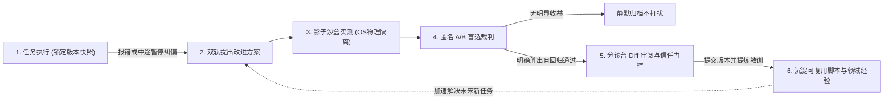

  

<h1>会自己长本事的桌面 AI Agent。</h1>

  <strong>别再一遍遍手改 Prompt 了。你只要中途纠正它一次，Harnex 就会在系统沙盒里自己写新工具、做匿名盲测验优、存入版本库——下次遇到同类任务，直接一把过。</strong>

  
  
  
  
  

  <a href="README.md">English</a> ·
  <strong>简体中文</strong> ·
  <a href="docs/ARCHITECTURE.md">架构与安全白皮书</a> ·
  <a href="docs/EVOLUTION_BLUEPRINTS.md">V2+ 开放共创蓝图</a>

> **V1.0 开发冲刺中**：Harnex 正在进行 V1.0 核心工程建设，本仓库率先开放产品愿景、安全架构设计与 V2+ 进化蓝图。点亮 **Star** 抢先关注首发安装包，或到 **Discussions** 投票决定 V2+ 下一个优先落地的功能！

---

## 60 秒看懂核心震撼：真正会“长记性”的桌面 Agent

  

市面上的大多数桌面 AI Agent 都是**“金鱼记忆”**——在你的本地文件格式、编码乱码或个人工作习惯上踩了一次坑，下周遇到同样的活还是会一模一样地翻车，除非**你**亲自去手改提示词或满世界找插件。

**Harnex 在不微调模型权重的前提下，自己给自己升级装备：**

1. **真实踩坑，中途纠偏**：你让出厂白纸版 `v0` 整理一批混合编码的桌面账单文件，它来回试错折腾了 `7 步 · 3 次报错`，或者你在运行中途点击 **暂停（Pause）** 指正了它一句。
2. **后台活体进化**：基于 Google Research **Harness²** 双层递归算法，Harnex 在后台复盘失败原因，**自己动手写出一个可复用的 TypeScript 解析脚本**，拉起隔离的影子沙盒验证零报错，再通过**正反序匿名盲选裁判（Blind Judge A/B）**确认新版真的大幅胜出——全程无需预设标准答案。
3. **换新数据直接起飞**：你点一下采纳落盘，面对一个**从未见过的新文件夹**，**完全相同的模型**直接调用自己刚造的新工具，**2 步 · 0 报错 · 省下 58% Token** 一把搞定。

| 你感受到的差异 | 传统静态桌面 Agent | ⚡ Harnex |
| :--- | :--- | :--- |
| **开箱状态** | 出厂塞满臃肿提示词与冗余插件 | **极简干净出厂种子** —— 只长出你日常真正用得上的本事 |
| **踩坑之后** | 下次照样犯错，逼你自己手改配置 | **自己写修复脚本** —— 在隔离影子沙盒验证有效后再入库 |
| **干活过程** | 要么干瞪眼看着跑偏，要么直接重开聊天 | **随时暂停纠偏（Pause → Steer）** —— 教它一次自动送进进化队列 |
| **桌面安全** | 脚本直接裸奔在系统权限里，网页注入可能持久化 | **Rust 四层保险库** —— OS 级物理沙盒、Hook SHA-256 指纹锁、防注入独立安审 |
| **升级风险** | 改了提示词后，原本能跑的旧任务悄悄退化 | **Git 时光机** —— 每次进化有 Diff、可对比 `v0/v1`、退化自动回滚 |

---

## 认识你的指挥台：Living Agent Command Deck

  

 

<table>
  <tr>
    <td width="50%" valign="top">
      <h3>⏸ 中途喊停，教它一次就长记性</h3>
      发现 Agent 方向跑偏了？随时点一下 <strong>暂停（Pause）</strong> 纠正方向后继续执行。当前任务照常立刻完成，同时这次人工纠偏会自动打标，驱动后台针对性自我进化。
    </td>
    <td width="50%" valign="top">
      <h3>🔬 进化现场直播，拒绝玄学黑盒</h3>
      实时观看它生成提案、在影子工作区实测跑分，以及匿名洗牌的 <strong>Blind Judge A/B 盲选推理</strong>。对它进化出的脚本某一行不满意？直接在 <strong>Diff 行内留批注</strong>，一键触发定向复进化。
    </td>
  </tr>
  <tr>
    <td width="50%" valign="top">
      <h3>⏪ 像管理代码一样回滚和分享你的 Agent</h3>
      所有进化都由内嵌 <code>libgit2</code> 自动保存为 Git 版本。用同一款便宜模型一键对比重跑 <code>v0 vs v1</code> 直观感受差距，随时一键回滚，还能经密钥/隐私扫描后导出基因包分享给社区。
    </td>
    <td width="50%" valign="top">
      <h3>🔌 10 秒接入你的模型，支持一键导入</h3>
      支持为 <strong>执行（Solver）</strong>、<strong>进化（Improver）</strong>、<strong>裁判（Judge）</strong> 分别指定模型（OpenAI 兼容 / Claude / Gemini / DeepSeek / 本地 Ollama），或一键只读导入 <strong>CC Switch</strong> 与本地 <strong>Magpie</strong> 网关。
    </td>
  </tr>
</table>

---

## 造得像金库一样稳：为什么敢放它真机干活？

  

让 AI 自己改写自己听起来很危险——但前提是你有没有用 Rust 把执行底座死死锁住。Harnex 让 Agent 的“大脑与工具箱”充分进化，同时把所有真实系统操作关进 **4 层对标 Codex 的安全金库**：

1. **真·系统级物理沙盒（`macOS Seatbelt` / `Linux bubblewrap & Landlock`）**：Agent 每次写文件、跑终端命令、甚至运行它**自己进化出来的脚本**，全都在 Rust 拉起的操作系统物理沙盒内执行——物理层面严禁触碰你的 SSH 密钥、系统目录以及 Harnex 自身的安全防线。
2. **聪明信任，不烦人**：你手动添加安装的 MCP 工具默认信任、零弹窗顺滑调用；Hook 脚本采用**首次信任 + SHA-256 指纹锁**，平时免打扰直接跑，哪怕被改了 1 个字节立刻失效并强制重新授权。
3. **隔离式安全审查员（`auto` 全自动模式）**：开启自动模式后，由独立的 Guardian AI 在**完全屏蔽网页与外部脏文件**的干净上下文里审查风险命令，彻底免疫提示词注入。涉及核心指令与可执行代码的新增进化，**永远必须经过你的一次显式信任**才可生效。
4. **原生钥匙串、花费熔断与健康自动回滚**：API Key 全存系统原生钥匙串，绝不落明文；Rust 强控每日费用上限防烧钱；内嵌 `libgit2` 持续监控成功率，一旦新进化版本导致任务频繁翻车，自动回滚到上一个健康版本。

### 自我进化是如何一步步闭环的？

> 想了解 `L0/L1/L2` 权限边界、`BUN_BE_BUN=1` 单文件沙盒、线程版本锁定及最低模型配置建议？欢迎阅读完整 [架构与安全白皮书](docs/ARCHITECTURE.md)。

---

## 首启 3 分钟震撼体验 & 平台支持

告别空白聊天框冷启动，也不搞弄虚作假的“魔法演示”：
- **🎬 录制回放模式（默认，免 API Key）**：打开软件即可零门槛看一遍真实录制的 `v0 → v1` 完整进化轨迹（明确标注为录制回放），3 分钟看懂核心机制。
- **⚡ 实时进化模式（配好供应商后开启）**：界面透明提示预计耗时与 Token 费用，用你自己的模型在 `dataset_a` 演练集与未见验证集 `dataset_b` 上真刀真枪跑完一次进化跃迁。

| 操作系统 | 支持级别 | OS 沙盒机制 | 钥匙串存储 |
| :--- | :--- | :--- | :--- |
| **macOS** | **完整支持** | Seatbelt (`sandbox-exec`) | macOS Keychain |
| **Linux** | **完整支持** | `bubblewrap` / `Landlock` | Secret Service (D-Bus) |
| **Windows** | **Beta** | Job Object + 受限令牌 + 路径规范化 *(文件系统隔离范围较 POSIX 弱，白皮书已如实披露)* | Windows Credential Manager |

---

## 出厂极简，开放共创（V2+ 进化蓝图）

Harnex V1.0 坚持精简、可控、可审计的内核，不闭门造车提前写死一堆用户不想要的复杂功能；我们在 [docs/EVOLUTION_BLUEPRINTS.md](docs/EVOLUTION_BLUEPRINTS.md) 公开了 6 大开放蓝图，由社区共同决定进化方向：

1. **进阶记忆系统** —— 分层记忆压缩与本地 SQLite 语义/图谱检索
2. **社区 Hook 共享库** —— 标准化防错、隐私脱敏与自动格式化钩子
3. **Skills 生命周期引擎** —— 跨领域模式挖掘、语义去重、合并与淘汰
4. **多子代理并行协同** —— 专职角色包与 DAG 并行执行树
5. **MCP 运维台与办公模板** —— 图形化诊断、OAuth 助手与开箱即用办公工具包
6. **进阶沙盒规则与 `views/` 动态视图** —— 单调加固安全策略与受限 L2 交互卡片

> **一起投票，甚至让 Harnex 自己发 PR**：点亮 **Star** 关注项目，去 **GitHub Discussions** 给你最想要的功能投票——或者直接把蓝图喂给你本地的 Harnex，让它自己进化出解决方案并提 PR！

---

## 开源协议与致谢

本项目基于 [Apache License 2.0](LICENSE) 开源。
核心双层递归进化机制衍生自 Google Research 的 [`google-research/harness2`](https://github.com/google-research/harness2)（Copyright 2026 Google LLC, Apache-2.0），详见 [NOTICE](NOTICE)。
