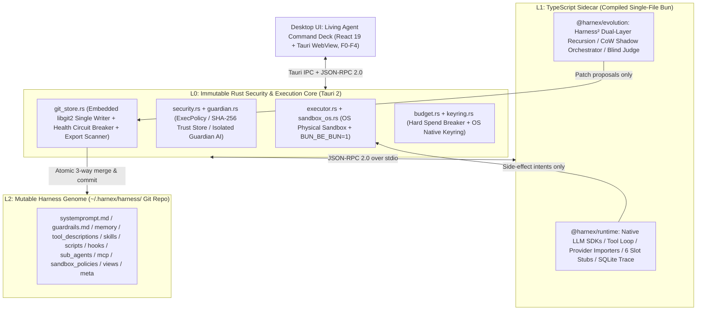
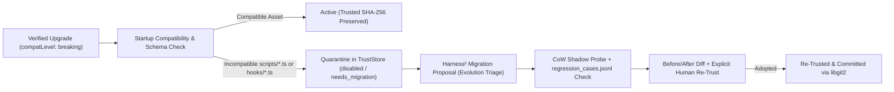

# Harnex Architecture

> *A minimal immutable desktop shell with a self-evolving Harness² core — born small, grows itself.*

Harnex separates **immutable execution & security (L0)** from **runtime orchestration (L1)** and the **mutable agent harness surface (L2)**.

---

## 1. Three-Layer System Architecture (L0 / L1 / L2)

**Core Invariant**: The TypeScript Sidecar (L1) **never** writes files, executes shell commands, runs scripts/hooks, or commits to Git directly. Every side effect is emitted as a typed intent (`ExecWriteFileIntent`, `ExecShellIntent`, `ExecScriptIntent`, `ExecHookIntent`, `GitCommitPatchParams`) and executed by Rust L0 inside an OS-level sandbox.

---

## 2. Codex-Style 4-Layer Security Model

| Layer | Component | Guarantee & Enforcement |
| :--- | :--- | :--- |
| **Layer 1: OS Physical Sandbox** | Rust `sandbox_os.rs` + `executor.rs` | • Default `workspace-write` mode: writes restricted to the bound workspace & temp dirs. • Physically blocks writes to `.git/`, `~/.harnex/harness/`, `~/.ssh/`, `trust.json`, and system directories. • Network disabled by default unless explicitly approved. • Agent-authored `scripts/*.ts` and `hooks/*.ts` run via embedded Bun (`BUN_BE_BUN=1`) **inside** the OS sandbox, closing Bun's lack of a built-in permission model. |
| **Layer 2: ExecPolicy & Trust Store** | Rust `security.rs` (`~/.harnex/trust.json`) | • Deterministic command prefix rules (`allow` / `prompt` / `forbidden`). • **MCP Trust**: User-installed MCP servers are trusted by default; RSI-proposed edits to `mcp/servers.json` require explicit human confirmation. • **Hook Trust (TOFU + SHA-256)**: Trusted hooks store their path + SHA-256 digest in `trust.json`. Zero-prompt execution while unchanged; **a 1-byte edit invalidates trust** and triggers re-approval. |
| **Layer 3: Approval Gateway & Isolated Guardian AI** | Rust `guardian.rs` | • **`manual` mode (default)**: Out-of-sandbox requests and high-risk commands prompt the user; all evolution proposals enter Evolution Triage. • **`auto` mode**: Commands requiring confirmation are routed to an **isolated Guardian AI** (`sanitizedInputOnly: true` — web pages, untrusted files, and untrusted MCP outputs are strictly excluded from Guardian's context to prevent prompt injection). • **High-Privilege Gate**: Even in `auto` mode, proposals touching `HIGH_PRIVILEGE_HARNESS_PREFIXES` (`scripts/`, `hooks/`, `mcp/servers.json`, `systemprompt.md`, `guardrails.md`) require Guardian pre-review **plus** explicit human trust before activation. |
| **Layer 4: Embedded `libgit2`, OS Keyring & Budget Breaker** | Rust `git_store.rs`, `keyring.rs`, `budget.rs` | • **Single Git Writer**: Embedded `git2` (no system `git` dependency); validates patches never touch `IMMUTABLE_L0_PATH_PATTERNS`. • **OS Keyring**: API keys live exclusively in macOS Keychain, Windows Credential Manager, or Linux Secret Service (`keyring` crate). • **Hard Budget Breaker**: Rust enforces per-model pricing & daily USD caps across all slots before LLM calls proceed. |

---

## 3. Platform Support Matrix (Honest Disclosure)

| Platform | Support Tier | OS Sandbox Backend | Keyring Backend | Known Limitations |
| :--- | :--- | :--- | :--- | :--- |
| **macOS** | **Full Support** | Seatbelt (`sandbox-exec`) | macOS Keychain | Full POSIX filesystem & network isolation. |
| **Linux** | **Full Support** | `bubblewrap` (`bwrap`) / `Landlock` | Secret Service (D-Bus) | Falls back from `bwrap` to `Landlock` on restricted kernels. |
| **Windows** | **Beta** | Job Object + Restricted Token + Rust Path Canonicalization | Windows Credential Manager | **Honest disclosure**: Windows native Job Objects & Restricted Tokens do not provide kernel-level per-path VFS bind-mounting equivalent to macOS Seatbelt or Linux `bubblewrap`/`Landlock`. Path containment relies on restricted tokens plus Rust canonicalization checks before spawn. |

---

## 4. Harness² Dual-Layer Recursion & Concurrency Consistency

Derived from [`google-research/harness2`](https://github.com/google-research/harness2) (Apache-2.0) and adapted for local desktop execution:

```mermaid
flowchart LR
    RUN["Task Run (Pinned: Commit SHA)"] -->|Failure or Human Pause->Steer| Q["Evolution Queue"]
    Q --> PROP["Dual-Track Propose (Invariant + Domain)"]
    PROP --> COW["On-Demand CoW Shadow Probe (Rust L0 OS Sandbox)"]
    COW --> COMP["Contrastive Compose"]
    COMP --> JUDGE["Blind Judge A/B (Shuffled Forward & Reverse)"]
    JUDGE -->|Loss / No Gain| ARCH["Silent Archive (NO_ENTRY)"]
    JUDGE -->|Win| REG["Bounded regression_cases.jsonl Check"]
    REG --> TRI["Evolution Triage (Diff + Inline Comment Re-Evolve)"]
    TRI -->|Adopt + Human Trust| MERGE["Rust libgit2 3-Way Merge (Needs Re-Probe on Conflict)"]
    MERGE --> LIB["meta/domains/<domain>/INDEX.md + EXPERIENCE.md (Cue/Lesson/Evidence)"]
    LIB -.->|Improves Future Proposals| PROP
```

### Concurrency & Reliability Guarantees
- **Snapshot Pinning**: Every foreground thread pins the Git `HEAD` SHA at start so background evolutions or rollbacks never tear mid-flight runs.
- **On-Demand CoW Shadow Probe**: Copies only files actually touched by the task (with per-file and total byte caps); external network writes / messaging tools switch to Dry-Run Mock.
- **Health Circuit Breaker (`auto` mode)**: Tracks rolling per-domain failure rate ($N=10$). If a new version degrades pass rate by $>20\%$ across $\ge 3$ tasks or fails 3 consecutive runs, Rust `git2` automatically reverts to the last healthy commit and notifies the UI.
- **Sanitized Export & Zero-Trust Import**: Genome exports exclude `memory/` by default and run a regex + entropy secret/PII scanner; imported packages disable all `scripts/`, `hooks/`, and `mcp/servers.json` entries until reviewed in the Trust Store.

---

## 5. Minimum Model Capability Recommendations

Harnex separates LLM responsibilities into three configurable slots (`ModelSlotSchema`):

| Slot | Role | Minimum Recommended Capability | Notes |
| :--- | :--- | :--- | :--- |
| **`solver`** | Foreground task execution (`Ask` / `Plan` / `Craft`) | Fast tool-calling model (e.g., Gemini 2.5 Flash, GPT-4o-mini, Claude Haiku, DeepSeek Chat) | Harness² is designed to amplify fast, economical Solver models (`v0 -> v1`). |
| **`improver`** | Contrastive trace diagnosis & patch generation | Mid-to-high reasoning model (e.g., Gemini 2.5 Pro, Claude Sonnet, o3-mini / GPT-4.1) | Needs reliable code/diff synthesis and adherence to `SurfaceSpec` constraints. |
| **`judge`** | Blind Judge A/B evaluation & `auto`-mode Guardian AI | Mid-to-high reasoning model, **heterogeneous from `improver` recommended** | Using a different model family than `improver` reduces self-preference bias in A/B selection. |

---

## 6. Upstream Auto-Updater, User Genome Isolation & Breaking-Change Protection Protocol

Harnex guarantees that upstream binary updates **never clobber** a user's evolved intelligence, trust decisions, or execution history.

### 6.1 Strict Binary vs. Genome Separation

| Surface | Replaced by App Update? | Lifecycle & Ownership |
| :--- | :--- | :--- |
| **L0 Rust Shell + Embedded Bun Sidecar + Desktop UI Binary** | **Yes** | Immutable application payload distributed via signed releases. |
| **`~/.harnex/harness/`** (User-evolved Git repository) | **Never** | `harness-seed/` only initializes an empty repository on first launch. Existing genomes are preserved across upgrades and downgrades. |
| **`~/.harnex/trust.json`** & **SQLite Traces** | **Never** | Trust digests, `ExecPolicy` rules, and run traces remain strictly under local user control. |

### 6.2 Release Compatibility Classification (`compatLevel`)

Every upstream release manifest declares a `compatLevel` so the updater surfaces exact impact before installation:

| `compatLevel` | Impact | Update Behavior |
| :--- | :--- | :--- |
| **`safe`** | Zero schema or runtime contract impact | Eligible for normal install after signature and SHA-256 verification. |
| **`auto_migrate`** | Additive schema/metadata evolution | Runs an **idempotent forward schema migrator** on `manifest.json` and SQLite `schemaVersion` tables on first boot. |
| **`breaking`** | Contract, API, or runtime behavior change affecting evolved assets | Requires explicit `migrationNotes` display and **human confirmation** before `updater_install` proceeds. |

### 6.3 Mandatory Pre-Update Snapshot Tag & Backup

Before `updater_install` executes any downloaded installer:
1. **Installer Verification**: Rust L0 verifies the release signature and exact **SHA-256** digest of the downloaded payload.
2. **Immutable Git Tag**: Rust `git2` creates an immutable annotated tag **`pre-update-vX.Y.Z-to-vA.B.C`** on the active `~/.harnex/harness/` `HEAD` commit.
3. **State Backup**: Snapshots of `manifest.json`, `trust.json`, and SQLite metadata are written to **`~/.harnex/backups/`**.

This guarantees **100% rollback safety**—even if a user downgrades the desktop binary back to `vX.Y.Z`, the exact pre-update genome and trust state remain intact and restorable.

### 6.4 Quarantine + Harness² Self-Healing Migration for Breaking Changes

- **Zero Silent Deletion**: Incompatible user `scripts/*.ts` or `hooks/*.ts` are **never deleted**; they are quarantined as `disabled / needs_migration` in `TrustStore` (`~/.harnex/trust.json`) so application startup never crash-loops.
- **Harness² Self-Healing Migration**: Quarantined assets are queued into a Harness² **Migration Proposal** in Evolution Triage—repaired against the new contract, validated via CoW Shadow probe and `regression_cases.jsonl`, and presented with a **Before/After Diff** requiring explicit human re-trust before reactivation.
- **Opt-In Upstream Seed Improvements**: New capabilities added to upstream `harness-seed/` are never force-applied; they are surfaced solely as **opt-in 3-way merge diffs** inside Evolution Triage.

